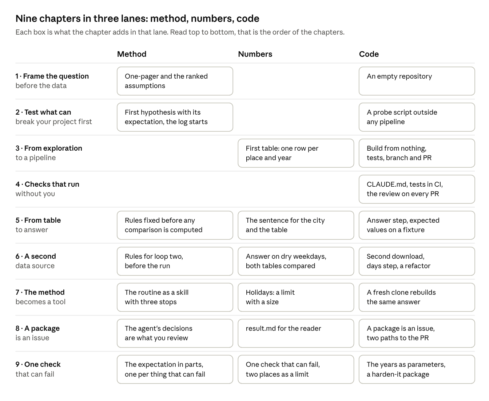

# A data project, from the question to a checked answer

This tutorial follows one example from an empty repository to a checked answer. The question arrived as a single sentence: "Is cycling in Zurich growing?"

Each chapter shows three things together: how to think about the step, how to build it, and how to do it with Claude Code. This folder holds the tutorial text. Everything else in this repository was built by the steps the chapters describe, so every result a chapter links to is the real one, at the state the chapter describes (the links point at a tag per chapter, `ch1` to `ch9`).

Everything in the tutorial sits in one of three lanes, and it helps to know which lane you are in:

- **Method.** The question, the assumptions behind it, the hypotheses with their expectation written first, the decisions, and the log that holds them. It is the same whether your project is about bikes, trains or vegetation.
- **Numbers.** The result itself: the rules it rests on, the sentence and the table, the known limits with a size, and the one check on a central number that could change the sentence. A hypothesis is a question about the project, a check is a question about a number, and the two are easy to mix up.
- **Code.** The repository: one command that builds everything from nothing, raw data that stays raw, tests on fixtures, a branch and a pull request per package, rules for the agent, and checks that run without you. It is what makes the other two lanes reproducible by someone else.

## The map

One row per chapter, one column per lane. A chapter with an empty cell adds nothing in that lane, and that is deliberate: chapter 4 is all code, chapters 1 and 2 have no number yet, and a number itself is checked only once, in chapter 9. No box weighs more than another.

## Chapters

| Chapter | What you have at the end |
| --- | --- |
| 1 · Frame the question before the data | A repository, a one-page framing of your question, and a ranked list of the assumptions your plan rests on |
| 2 · Test what can break your project first | The one assumption that could end your project is tested, and your plan has changed because of what you found |
| 3 · From exploration to a pipeline | One command builds your first result table from nothing, on any machine, and a test guards the logic behind it |
| 4 · Checks that run without you | Every pull request is checked before you look at it: the tests run by themselves, a red result blocks the merge, and a reviewer reads the change against your own rules |
| 5 · From table to answer | One command ends in a sentence that answers the question |
| 6 · A second data source | A second data source is in the pipeline, with its own download, step and fixture, and nothing that existed had to change |
| 7 · The method becomes a tool | The hypothesis routine is a skill that runs the same way every time, and a fresh clone builds the same answer with one command |
| 8 · A package is an issue | Every package is written down as an issue before the branch exists, done by the agent on your laptop or by the App on GitHub, and reviewed by what the agent decided, not by the diff |
| 9 · One check that can fail | The central number has the one check behind it that could have changed the sentence, chosen from five, with the expectation written first, and the part that failed is in the one-pager with its number |

## When to read what

The chapters follow the example, not your calendar. For your own project:

- Chapters 0 to 3 before the kickoff: the map, the one-pager, the first hypothesis, the first pipeline.
- Chapters 4 and 8 before the first pull request: the checks that run without you, and the package as an issue.
- Chapters 5 to 7 when the first answer is in sight: the sentence, the second source, the method as a skill.
- Chapter 9 before a central number goes into the report: the one check that can fail.

## How to use the prompts

Prompts and commands stand in grey boxes. Move the mouse over a box and a copy button appears at its top right.

The prompts are broken into short lines so that you can read them without scrolling sideways. Paste them as they are. Claude Code does not mind the line breaks.

The prompts belong to the example. For your own project, keep their structure and replace the details: your question, your data, your fixture and your expected values.
