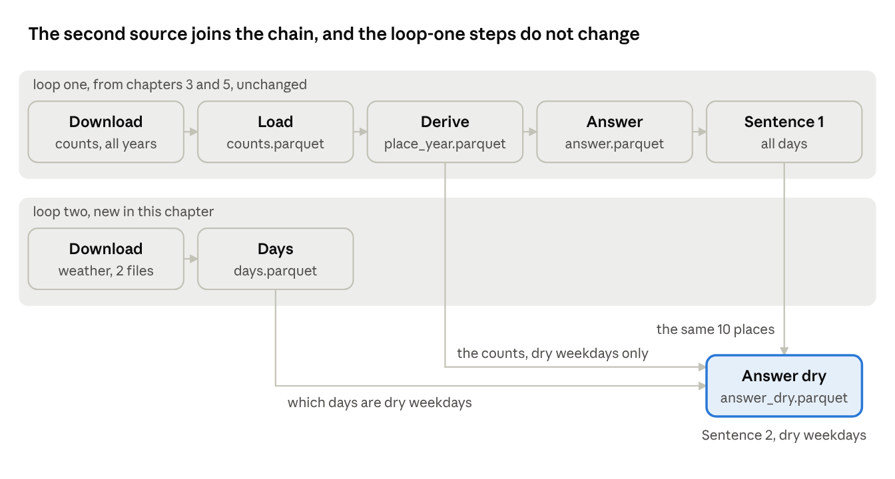

# DS-Projekt 2026 tutorial · Chapter 6 · A second data source

Oct 15, 2026 · Václav Pechtor

## What you have at the end

Most projects do not fall apart on the first data source. They fall apart on the second. Everything that was neat for one source gets bent to fit the next: the download grows a special case, the clean step learns a second format, a date column is parsed twice in two ways, and the tests that guarded the first source no longer say anything about the whole. This chapter adds a second source without any of that happening.

The case is only the occasion. Loop one answered whether cycling grew. Loop two asks whether it still grew when the weather is taken out, and for that the pipeline needs the city's weather data. Every team project joins sources, so the method is what matters, and the numbers in the chapter only illustrate the steps.

What keeps the project together when a source is added:

- **Know what you need from the source before it enters.** One rule, decided first, and one cheap count that tells whether the source can deliver it.
- **Give the source its own download, step and fixture.** Reuse what exists and change nothing in it. The old tests stay green and untouched.
- **Where the source has a case the rule does not cover, stop.** A decision or an error, never a quiet guess.
- **Let the sources meet in one place only.** The last step reads both. Everything before it knows one source.
- **Keep the rules binding when it gets uncomfortable.** The package too large, the source that moves under a rebuild.

This is the first chapter without a new tool, and the shortest.



The upper row is the pipeline from chapter 5. Its steps produce exactly what they did before, and the one change to their code, a refactor, comes up in the last section. The lower row is the new source: its own download and its own step. The two meet in exactly one place, the last step, which reads the counts, the day table and the first answer.

One more rule sits in the picture: the new source changes one thing. The places, the years, the band and the majority rule are those of loop one, and only the days change. A source that changes several things at once cannot say which one made the difference, and neither can you when something breaks.

## Know what you need from the source before it enters

A source enters the pipeline for one reason, and that reason is written down before a byte is downloaded: which rule it serves, and what it must deliver for the rule to work.

The one-pager had carried an open point since chapter 1: what counts as a dry weekday. It is decided now, because the second source exists for it, and not earlier. These are the rules:

| Rule | Decision |
| --- | --- |
| Weekday | Monday to Friday. Known limit: public holidays count as weekdays |
| Dry | Zero minutes of rain that day at one station, Stampfenbachstrasse. Known limit: one station stands for the whole city |
| Source | The city's daily weather data, one CSV per year |
| Places and years | The same 10 comparable places and the same two years as loop one. The band and the majority rule stay |

The simplest reading won each time. The weather data gives minutes of rain per day, so "dry" needs no threshold. One station is a limit, and it is named as one. The source serves this rule and nothing else, which is what keeps the step that reads it small.

**Can the source deliver?** That is the one thing to test before building anything on it. Here the risk was too few days: about 120 of the 261 weekdays in a year are dry, and the 300-day rule of loop one cannot apply. So one count, with the expectation written first: for each of the 10 places and each year, at least 80 dry weekdays with bike data.

The prompt for this package:

```text
Docs-only package for loop two: fix the rule for a dry weekday before any
comparison is computed, and test whether enough days remain.

My decision, to log and to write into docs/one-pager.md where the point is open:
- Weekday: Monday to Friday. Known limit: public holidays count as weekdays.
- Dry: a day with zero minutes of rain, parameter RainDur with daily values, at
  the station Zch_Stampfenbachstrasse.
  The source is the city's daily weather data, one CSV per year at
  https://data.stadt-zuerich.ch/dataset/ugz_meteodaten_tagesmittelwerte/download/ugz_ogd_meteo_d1_<year>.csv.
  Known limit: one station stands for the whole city.
- Places and years: the same 10 comparable places and the same years, 2019 and
  2025, as the first answer.
  The 5 percent band and the majority rule stay.

Then add a hypothesis entry in the usual form.
Hypothesis: enough dry weekdays with bike data remain at the comparable places.
Expected: at least 80 dry weekdays with bike data per place in each of the two
years, at all 10 places.
Test: for each of the 10 comparable places in data/derived/answer.parquet and
each of the two years, count the days that are a dry weekday and have bike data
in data/derived/counts.parquet.
Download the two weather files once for this count, outside data/raw, and do not
add them to the pipeline.
Record the counts, leave Decision empty, and compute no change between the
years.
```

Two things in it matter for any source you add:

- **The count runs outside the pipeline.** The files are downloaded once, into no place the pipeline uses, and thrown away. Nothing enters the repository before the source has shown that it can deliver. This is the "find out" kind of package from chapter 5.
- **The prompt says nothing about planning, branches, pulling `main` or holding the commit.** The rules file carries all of that now, and the agent did all of it.

The count came out at 117 to 130 dry weekdays with bike data per place and year, well above the 80. The expectation held, and the Decision line says that the rules stand and the source may enter. A hypothesis that holds is a result too: without it, the next two packages would have been built on a guess.

**One question came back** before the count: what about a weekday without a known rain value at that station? The rule did not say. The agent proposed the safe reading, such a day is not dry, and asked. That became part of the rule.

Result: [pull request 15](https://github.com/vp-82/ds-projekt-2026-tutorial/pull/15), docs only, 46 lines. The weather data: [Täglich aktualisierte Meteodaten, seit 1992](https://ckan.opendata.swiss/dataset/taglich-aktualisierte-meteodaten-seit-1992).

## The source gets its own download, step and fixture

A new source does not get wired into the steps that exist. It gets its own download, its own step that turns it into the one table the project needs from it, and its own fixture. The steps of the first source do not change, and the tests that guard them stay green without being touched.

The weather data looks nothing like the counts. It is one CSV per year, with one row per day, station and parameter, and the rain is given as minutes per day. The pipeline needs one thing from it: for every day, is it a dry weekday or not. So the new step, `days`, writes one row per day with the date, the rain minutes at the chosen station and a flag. Everything about the weather format stays inside that one step.

The prompt:

```text
Package: the weather source enters the pipeline.
Add it to uv run build, right after the existing download step.

Download the two weather files for the years in the rules for loop two, 2019 and
2025, with the existing download step, so they land in data/raw with a manifest
line each.
Then a new step named days writes data/derived/days.parquet: one row per day
that appears in the weather files, with the date, the rain minutes at
Zch_Stampfenbachstrasse and a flag dry_weekday that follows the rules for loop
two in docs/one-pager.md.
Put the logic in a function that takes the weather table and returns the day
table.

Create tests/fixtures/weather_small.csv with exactly this content and do not
change it.
If the real files do not fit its format, tell me.

Datum,Standort,Parameter,Intervall,Einheit,Wert,Status
2020-03-02T00:00+0100,Zch_Stampfenbachstrasse,RainDur,d1,min,0,bereinigt
2020-03-02T00:00+0100,Zch_Stampfenbachstrasse,T,d1,°C,4.2,bereinigt
2020-03-03T00:00+0100,Zch_Stampfenbachstrasse,RainDur,d1,min,12.5,bereinigt
2020-03-04T00:00+0100,Zch_Stampfenbachstrasse,T,d1,°C,5.1,bereinigt
2020-03-05T00:00+0100,Zch_Rosengartenstrasse,RainDur,d1,min,0,bereinigt
2020-03-06T00:00+0100,Zch_Stampfenbachstrasse,RainDur,d1,min,,bereinigt
2020-03-07T00:00+0100,Zch_Stampfenbachstrasse,RainDur,d1,min,0,bereinigt

The test must find exactly these rows: 2020-03-02 with 0 rain minutes and
dry_weekday true, 2020-03-03 with 12.5 and false, 2020-03-04 with no rain value
and false, 2020-03-05 with no rain value and false, 2020-03-06 with no rain
value and false, 2020-03-07 with 0 and false.

Afterwards tell me from the real data how many dry weekdays days.parquet holds
in 2019 and in 2025.
The hypothesis entry in docs/log.md counted 120 and 130 another way.
```

The fixture is seven rows in the format of the real file, a Monday to a Saturday, and each row stands for one rule:

| Row | Tests |
| --- | --- |
| 03-02, 0 minutes | A dry weekday |
| 03-02, a temperature | Other parameters are ignored |
| 03-03, 12.5 minutes | A wet weekday |
| 03-04, a temperature only | A day without a rain value is not dry |
| 03-05, another station | A rain value elsewhere does not count |
| 03-06, no value | A missing value is not a known value |
| 03-07, 0 minutes | A dry Saturday is not a weekday |

What to look for in the result, and in your own project:

- **The download step was reused as it is.** No new download code, no special case for a CSV. The build fetches three files, and the manifest gets a line for each.
- **Nothing that existed changed.** The seven tests of loop one passed untouched, and three new ones came with the step. The counts, the table per place and year and the first answer are exactly as before. If a new source makes an old test change, something is wired into the wrong place.
- **The step was checked against a number from another route.** The one-off count of the last package found 120 and 130 dry weekdays. The pipeline step finds the same. That is the check from chapter 3, applied to a new source, and it is what the last sentence of the prompt asks for.

Result: [days.py](https://github.com/vp-82/ds-projekt-2026-tutorial/blob/main/src/ds_projekt_2026_tutorial/days.py), the fixture [weather\_small.csv](https://github.com/vp-82/ds-projekt-2026-tutorial/blob/main/tests/fixtures/weather_small.csv) and [pull request 16](https://github.com/vp-82/ds-projekt-2026-tutorial/pull/16), 144 lines in seven files.

## Where the source has a case the rule does not cover, stop

A new source always brings cases the rule did not foresee, because the rule was written before anyone had read the files. When the agent finds one, the answer is the loud option: a decision in the rule, or a step that stops with an error. Never a quiet guess, because a quiet guess is how a second source bends the project without anyone noticing.

The weather data brought four such moments in three packages. All four were raised by the agent, and none was in a prompt.

| The agent asked | The answer | Where it lives now |
| --- | --- | --- |
| A weekday without a known rain value at the station: dry or not? | Not dry. A day counts as dry only when we know it was | The rule in the one-pager |
| A day with two rain values at the station? The real files have none | The step stops with an error that names the day | `days`, with a test |
| The fixture tests an empty field, but the real files write `NA` for a missing value | The fixture row changed from empty to `NA` | The fixture |
| A comparable place without dry-weekday data in one of the years? Cannot happen with the real data | The step stops with an error that names the place | `answer_dry`, with a test |

Two of the four are decisions, and they went into the rule and the fixture, as in chapter 5. Two are cases that cannot happen with the data as it is. For those, deciding what the number should be would be a guess that nobody can check. An error is better: the pipeline stops, says what it found, and you decide when it happens. Each error got a test, written with a small input inside the test itself, because the fixture describes the normal case and an error is not one.

The third row is the one to remember. The fixture was written before the files were read, and it tested a case the real files never contain. The agent noticed, said so, and the row was changed by me, because the fixture is mine. A fixture that does not match the real format guards nothing.

None of this is in `CLAUDE.md`. There is no rule that says "stop with an error instead of guessing". The agent reads the log and the fixtures, sees how the project decides, and asks in the same form. A repository that records its decisions teaches the agent how to make the next one.

Result: the Decision entries of 2026-10-14 and 2026-10-15 in the [log](https://github.com/vp-82/ds-projekt-2026-tutorial/blob/main/docs/log.md).

## Let the sources meet in one place only

Everything before the last step knows one source. The last step is the only place where the two are read together, and it is built like any other step: the expectation into the log first, a fixture that can tell the rules apart, one independent check, and a line in the log that says what the result means.

The new step, `answer_dry`, reads the counts, the day table and the first answer. It keeps the counts of dry weekdays, builds the table per place and year from them with the function that already exists, and applies the rules of loop two. Its output has the same columns as the first answer, and its printed line is a second sentence for the city. The first answer step produces what it did before, and so does the sentence it prints.

Two things made this step safe to build:

**Which places count was decided by loop one, not by the new data.** A place is comparable on dry weekdays when it was comparable on all days. The new source does not get to change the set of places, so a difference between the two answers has one cause.

**The fixture reuses the five places of loop one** with new numbers, chosen so that the test can tell the rules apart:

| Place | Loop one | Dry weekdays | What it tests |
| --- | --- | --- | --- |
| 1000/2000 | Grew, +20 | 150 to 180, +20 | Stays grew |
| 3000/4000 | Shrank, −25 | 220 to 165, −25 | Stays shrank |
| 5000/6000 | Unchanged, +3 | 120 to 138, +15 | A status that flips |
| 7000/8000 | Not comparable | Data in both years | Comparable comes from loop one, not from the day counts |
| 9000/1000 | Not comparable | 2025 only | Stays not comparable |

For the city the fixture says yes, where the loop-one fixture says no. A sentence that differs from loop one proves that it is computed fresh and not copied.

**The check is the two answers side by side,** place by place. Every difference between the columns has to have a visible reason in the numbers, and it does:

| Place | All days | Dry weekdays |
| --- | --- | --- |
| 2681319/1248665 | grew +43.6 | grew +34.6 |
| 2681339/1248647 | grew +9.2 | unchanged +4.6 |
| 2682296/1248311 | shrank −7.4 | shrank −14.0 |
| 2682375/1247055 | grew +5.4 | unchanged −1.3 |
| 2682731/1247708 | shrank −20.4 | shrank −24.5 |
| 2682873/1245891 | grew +32.3 | grew +25.5 |
| 2682881/1246549 | grew +31.5 | grew +23.2 |
| 2682933/1248821 | grew +13.0 | grew +5.4 |
| 2683457/1247065 | grew +89.5 | grew +64.6 |
| 2684006/1246566 | grew +38.9 | grew +28.3 |

The result for the case: the answer holds on dry weekdays, and it is weaker. 6 of 10 places grew instead of 8, one of them just above the band, and every place moved in the same direction. The Decision line in the log says exactly that, reports both sentences, and leaves the why alone, because causes are a non-goal in the one-pager. The margin matters for one reason only: the band and the majority rule were fixed before, so nobody can move them now to get a rounder result.

Two questions came back before the build, and both are about keeping the two answers comparable. Should the new sentence keep the wording of loop one with only the opening changed? Yes, so that the two can stand next to each other. Should places that cannot be compared keep their bikes per day, as in loop one? Yes, for the same reason. A second source that produces a second format for the same kind of result has already started to bend the project.

Result: [answer\_dry.py](https://github.com/vp-82/ds-projekt-2026-tutorial/blob/main/src/ds_projekt_2026_tutorial/answer_dry.py), the fixture [place\_year\_dry\_small.csv](https://github.com/vp-82/ds-projekt-2026-tutorial/blob/main/tests/fixtures/place_year_dry_small.csv), the entry "The answer holds on dry weekdays" in the [log](https://github.com/vp-82/ds-projekt-2026-tutorial/blob/main/docs/log.md), and [pull request 18](https://github.com/vp-82/ds-projekt-2026-tutorial/pull/18).

## What keeps it from falling apart afterwards

The source is in, and the moment a project starts to slip is now: the rules that were easy to keep for one source get bent for the second. Three things happened in these two days that a rule had to hold against.

**The package that grew.** The last package came to about 255 lines, over the limit of about 200. Part of it was a change to the loop-one step, `answer.py`, so that both answers share the band and the sentence. That is the exact point where a second source starts bending the first one's code, and the rule caught it: the agent named the number and proposed a split. The change to the old step became its own pull request, 27 lines of code and a log entry, with no change in results and the seven old tests passing untouched as the proof. A refactor is a package whose check is that nothing moved, and it must never travel inside a package that adds something.

**The 230 lines that stayed.** With the refactor out, the answer package still had 230 lines. 111 of them are the test file and 10 the fixture, both of which a reader checks line by line anyway. The rule says "about 200", and this is what "about" is for. The reason is in the pull request, and that is the difference between a rule bent and a rule ignored.

**The source that moved.** The last check ran the full build with `--force`. That rebuilds every step including the downloads, and the counts file on the portal had grown by a week since chapter 5. The base of the work had changed in the middle of a package. The manifest showed it: three new lines, and for the counts file a new size and hash. The agent rebuilt everything from the new file, compared every result with the old ones, found them unchanged, and wrote it into the log. Two things follow. The manifest from chapter 3 is what makes a moved source visible at all. And `--force` has earned a hardening package: one flag for the derived tables, a separate one for the downloads.

The same run showed that the one-pager named the date to which the counts data runs, now wrong for the second time. One line points to the manifest instead. A number that changes with every download does not belong in a file that describes the project.

**What it cost.** Five pull requests in two days: the rule, the source, the refactor, the step where the sources meet, and one line in the one-pager. No new tool, no new rule in `CLAUDE.md`, no change to any step of the first source. Everything chapters 1 to 5 built was used, and nothing had to be rebuilt. That is the return on the six hardening packages of loop one: the first source pays for the setup, and every source after it runs on that setup.

Result: the refactor in [pull request 17](https://github.com/vp-82/ds-projekt-2026-tutorial/pull/17), the one-pager line in [pull request 19](https://github.com/vp-82/ds-projekt-2026-tutorial/pull/19), and the re-download in the checks of the entry "the answer on dry weekdays" in the [log](https://github.com/vp-82/ds-projekt-2026-tutorial/blob/main/docs/log.md).

## For your own project

1. Before a source enters, write down which rule it serves and what it must deliver. Take the simplest reading, and name every limit.
2. Test whether the source can deliver with one count outside the pipeline, with your expectation written first. Nothing enters the repository before that.
3. Give the source its own download, its own step and its own fixture, with one row per rule. Reuse what exists and change nothing in it. If an old test has to change, the wiring is wrong.
4. Check the new step against a number you got another way.
5. When the source has a case the rule does not cover, decide it or let the step stop with an error. Every decision gets a row or a test.
6. Let the sources meet in one step only, and let the rules of the first source decide what is compared. Put the two results side by side.
7. When a package starts to change the old source's code, split that part off. When a package is still over the limit, write the reason into the pull request.
8. After every forced rebuild, read the manifest. When a source moved, compare every result before and after.

---

Previous: [Chapter 5 · From table to answer](chapter-5.md) · [Overview](README.md) · Next: [Chapter 7 · The method becomes a tool](chapter-7.md)
