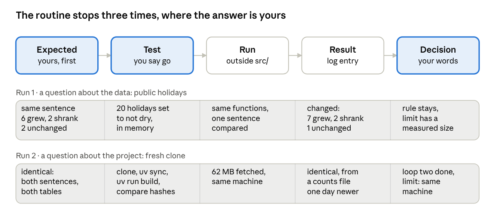

# Chapter 7 · The method becomes a tool

Oct 16, 2026 · Václav Pechtor

## What you have at the end

Chapter 4 automated the checks on a change: the tests run by themselves and a reviewer reads the diff against your rules. This chapter automates the method itself. The hypothesis routine, run by hand five times in the chapters before, becomes a skill that runs the same way every time, and then the skill is used twice: once on a question about the data and once on a question about the project.

That is the point of the chapter. A method is not a habit of one case. The same three stops, the same entry in the log and the same honesty about what was not tested work whether the question is "do public holidays change the sentence" or "does the project build without me".

At the end you have:

- **A procedure as a skill.** The routine lives in one file in the repository, loads only when you type it, and stops at three points where the answer is yours: the expected result, the go for the test, the decision.
- **One routine, two questions.** A data question that failed and changed nothing, because a failed hypothesis is a measured limit. A project question that held, with the one thing it did not prove written down.
- **What happened beyond the skill.** The fix that chapter 6 announced, in its own pull request, and what the project looks like now.
- **The end of the basics.** The project builds from a fresh clone with one command and gives the same answer, even though the source moved while we worked.

No new tool. One new feature of Claude Code, skills, and the one command that goes with it.



The row is the skill. The three marked boxes are where it waits for you. The two bands below are the same five steps, filled once with a question about the data and once with a question about the project.

The chapter closes the basics of the tutorial. What follows are deep dives into single tools.

## A procedure becomes a skill

The rules file holds facts and constraints that apply to every task, and Claude Code loads it every time. The hypothesis routine is something else: a procedure with steps, used only when you start it. The Claude Code documentation has a test for this. A skill is due "when a section of CLAUDE.md has grown into a procedure rather than a fact". A skill is one file, `.claude/skills/<name>/SKILL.md`, read only when it is used, and committed with the repository, so your team gets it with a clone.

The prompt that made it, in full, because the structure is what you reuse:

```text
Method package: the hypothesis routine in docs/log.md has been run by hand three
times and is a procedure, not a fact, so it becomes a project skill.
Create .claude/skills/hypothesis/SKILL.md so that /hypothesis <statement> runs
the routine the same way every time: restate the hypothesis in one sentence, ask
me for the expected result and wait for it, propose the cheapest test that can
break the hypothesis and wait for my go, run the test outside the pipeline,
write a Hypothesis entry in docs/log.md in the format of the existing entries
with Expected, Test, Result and Decision, and stop there, no change to src/ or
the rules.
Set disable-model-invocation: true so that the skill runs only when I type it.
Open an issue first with what the skill does and why it is a skill and not a
rule in CLAUDE.md.
Add a line to the README on how to run it.
Stop when the skill exists, I will run it myself.
```

The three stops are the prompt's core. The expected result is given before a result exists, that is what makes a statement a hypothesis. The go comes after you have read the test and what it does not compute. The decision comes after the result, in your words. At none of the three does the agent propose a value. This is where the rule "fixtures and expected values are mine" from chapter 3 gets its procedure.

`disable-model-invocation: true` means the skill runs only when you type `/hypothesis`, never because Claude Code decided a hypothesis was due. The student decides when to test, the tool runs the test the same way every time.

The plan came back with three questions, as plans do. All three answers are yours in your own project, so here they are with the reason:

| Question from the plan | Answer | Why |
| --- | --- | --- |
| Who writes the Decision? | You. The skill reports the result, asks, and writes your words unchanged. | The decision is the one step that cannot be delegated. |
| Does the skill write an AI use entry too? | Yes, a short one after each Hypothesis entry. | Otherwise the rule "AI use goes into the log" breaks on every run. |
| The skill writes to the log. What if you are on main? | It creates a branch `hypothesis-<slug>` first. On another branch it writes there. | A hypothesis is a package of the "find out" kind and gets its own pull request. |

The result: [SKILL.md](https://github.com/vp-82/ds-projekt-2026-tutorial/blob/main/.claude/skills/hypothesis/SKILL.md), 74 lines, [issue 23](https://github.com/vp-82/ds-projekt-2026-tutorial/issues/23) and [pull request 24](https://github.com/vp-82/ds-projekt-2026-tutorial/pull/24), 86 lines in three files.

One thing to know before the first run. After the merge, `/hypothesis` was an unknown command. Claude Code watches the skill folders that existed when the session started, and `.claude/skills/` was new. One command fixes it:

```
/reload-skills
```

A new session loads it too, and that is what your team mates get after a clone.

The documentation on skills is at [code.claude.com/docs/en/skills](https://code.claude.com/docs/en/skills).

## One routine, two questions

The skill ran twice. The first question was about the data, the second about the project. Both start with one typed line, the whole statement after the command:

```text
/hypothesis Public holidays make no difference: the dry-weekday sentence is the
same when the Zurich public holidays that fall on a weekday are taken out of the
dry weekdays.
```

```text
/hypothesis Someone else can rebuild it: a fresh clone of the repository in a
new folder, uv sync and uv run build, gives the same two sentences and the same
answer tables as my working copy.
```

The two runs side by side. Every row is one step of the routine, and the right column answers the same question as the left, only about the project instead of the data.

|  | Public holidays | Fresh clone |
| --- | --- | --- |
| Why this one | The one-pager has carried "public holidays count as weekdays" as a known limit since loop two. The size of the limit was unknown. | The one-pager's Done says "someone else can rebuild the table from nothing with one command and gets the same numbers from the same raw files". Nobody had tried. |
| Expected, given first | The sentence stays the same: yes, 6 grew, 2 shrank, 2 unchanged. | Yes: both sentences and both answer tables identical, and the test reports whether the three raw files have the same sha256. |
| The test | A copy of the day table in memory, the 20 holidays of 2019 and 2025 set to not dry, the existing functions unchanged, one sentence compared. Nothing written. | A clone in a new folder, `uv sync`, `uv run build`, then the sentences, the two tables row for row and the manifest hashes compared with my working copy. |
| How it could fail | Two places have a change within half a point of the 5 percent line that separates unchanged from grew. | The portal moved the counts file, the environment differs, or the build needs something that exists only on my machine. |
| Result | The sentence changed: 7 grew, 2 shrank, 1 unchanged. One place went from +4.6 to +6.8 percent and so from unchanged to grew. The city stays yes. | Sentences and tables identical. The counts file was not the same: the portal had moved it again, one day newer. The weather files were. |
| Decision, in my words | Rule stays. The limit has a measured size now, one place and not the city. One line in the one-pager. | Loop two is done. The result holds when the source moves. Known limit: the clone ran on my machine, with the same Python and the same uv cache. One line under Done. |
| The package | [Pull request 25](https://github.com/vp-82/ds-projekt-2026-tutorial/pull/25), 21 lines, documentation only. | [Pull request 26](https://github.com/vp-82/ds-projekt-2026-tutorial/pull/26), 21 lines, documentation only. |

> [!TIP]
> **A failed hypothesis is not a failure. It is a limit with a number on it.**
>
> *Before:* the rule "a weekday is Monday to Friday" treated public holidays like any other weekday. The one-pager listed that as a known limit, without a size. *After:* the size is known. Without the holidays, one of the ten places changes its label from unchanged to grew, because its growth goes from 4.6 to 6.8 percent and the rule calls everything above 5 percent growth. The other nine keep their label, and the answer for the city stays yes.
>
> *The fix on the table:* take the holidays out of the weekdays. It would buy the better rule. It would cost a package of about a hundred lines in the days step, with a holiday list, a fixture and expected values, a changed sentence in the README, and chapter 6's numbers would no longer match the repository.
>
> *How to decide:* pay when the question needs it. The question is whether cycling grew in the city, and the answer for the city does not move. So no.
>
> *What it did cost:* one entry in the log and one line in the one-pager, 21 lines in all.

> [!TIP]
> **A Done line is a claim. The check under it says how far the claim was tested, and what it was not.**
>
> *Before:* the one-pager's Done said "someone else can rebuild the table from nothing with one command and gets the same numbers from the same raw files". Nobody had tried. *After:* a clone in a new folder, `uv sync` and `uv run build` gave the same two sentences and the same two tables. But not from the same raw files: the portal had published a newer version of the counts file in the meantime, the clone downloaded that one, and the results for 2019 and 2025 came out the same anyway. And the clone ran on my own computer, with the same Python and the same package cache, not on someone else's.
>
> *The fix on the table:* run the build on another machine, for example in GitHub Actions. It would buy the proof that is missing. It would cost a download of 62 MB on every run and would undo the decision of chapter 4 to keep the raw data out of CI.
>
> *How to decide:* pay when the question needs it. The project ends here, and its reader is one planner, not a team on many machines. So the limit is written down instead.
>
> *What it did cost:* one entry in the log and one line under Done, 21 lines in all.

> [!TIP]
> **A skill's rules are defaults. Your instruction counts for more, and the agent has to say which rule it bent.**
>
> *Before:* the skill's last step says it never changes the one-pager. *After:* my decision for the holiday run asked for a line in the one-pager, in the same package. The agent wrote the line and reported, in the same message, which step it had bent and why. It neither refused nor hid it.
>
> *The fix on the table:* change the skill so that a decision may add a line to the one-pager. It would buy nothing, because your instruction after the skill stops already covers the case. It would cost a skill that allows a little more each time a case comes up.
>
> *How to decide:* a skill changes when the routine changes, not when one run needs an exception. So the step stays.
>
> *What it did cost:* nothing. One sentence in the agent's report.

## What happened beyond the skill

One more pull request went in, the fix that chapter 6 announced. `--force` now rebuilds the derived steps and leaves the raw files alone, and the new `--force-download` fetches them again. It had an issue first, a test that failed before the change and passed after it, and one reworded line in the rules file. The details are in [issue 21](https://github.com/vp-82/ds-projekt-2026-tutorial/issues/21) and [pull request 22](https://github.com/vp-82/ds-projekt-2026-tutorial/pull/22).

Seven hypotheses carried the project from the empty repository to here, every one with its expected value written down before the test ran. Three failed. Each failure left a measured limit and a decision, not a broken project:

| Chapter | Hypothesis | Expected | Result | Held? | Decided |
| --- | --- | --- | --- | --- | --- |
| 2 | The counting sites are the same every year | at least 80 percent of the sites report in every year | 0 percent, a site gets a new ID every few years | no | the unit of the table is the place, found by its coordinates |
| 5 | Enough places are comparable to answer for the city | at least 20 of 44 places | 10 of 44 | no | the rules stay, the answer names the 10 places and the 34 it cannot compare |
| 5 | Cycling grew at the comparable places | at least 6 of 10 grew | 8 of 10 | yes | the first answer stands, loop one is done |
| 6 | Enough dry weekdays with bike data remain | at least 80 per place and year | 117 to 130 | yes | the rules for loop two stand |
| 6 | The answer holds on dry weekdays | at least 6 of 10 grew, city yes | 6 of 10, yes | yes | it holds and is weaker, both sentences are reported |
| 7 | Public holidays make no difference | the same sentence | one place changed its label | no | the rule stays, the limit has a size |
| 7 | Someone else can rebuild it from a fresh clone | the same sentences and tables | the same, from a newer counts file | yes | loop two is done, limit: same machine |

Still untested, three of them written as such in the one-pager and one in the log: a day with a partial outage counts as a full day, one weather station stands for the whole city, the build on another machine, and, in the log only, whether the ten counting places stand for the whole city. Each is a hypothesis for whoever picks the project up, and the skill is there for it.

This closes the basics. The project now has one command that builds everything from nothing, two sentences at its end, 13 rules, 17 tests, a log with seven hypotheses, one skill, and a one-pager whose Done has been checked by a clone. The source moved twice while we worked and the answer did not. That is the state to be in before going deeper.

## For your own project

1. When a part of your rules file reads like steps, make it a skill. Facts and constraints stay in `CLAUDE.md`, procedures go to `.claude/skills/<name>/SKILL.md`, committed with the repository.
2. Put the stops where the answer must be yours. For a hypothesis that is the expected result, the go for the test and the decision. At a stop the agent asks and waits, it never proposes the value.
3. Set `disable-model-invocation: true` on a method skill. You decide when the method runs.
4. A skill's rules are defaults. Your instruction counts for more, and the agent has to say which rule it bent.
5. Run the routine on questions about the project, not only about the data. "It builds from a fresh clone" is a hypothesis with an expected value and a test that can fail.
6. A failed hypothesis is not a failure. It is a limit with a number on it. Write the number next to the rule, and change the rule only when the question needs it.
7. A Done line is a claim. The check under it says how far the claim was tested, and what it was not.
8. Fix a loose end in its own small package before the next feature, with an issue, a failing test and a one-line change to the rules if they said something else.
9. After a clone, a skill loads with the session. Added mid-session, it needs `/reload-skills` once.

---

The chapter ends here. The basics do too.

---

Previous: [Chapter 6 · A second data source](chapter-6.md) · [Overview](README.md) · Next: [Chapter 8 · A package is an issue](chapter-8.md)
