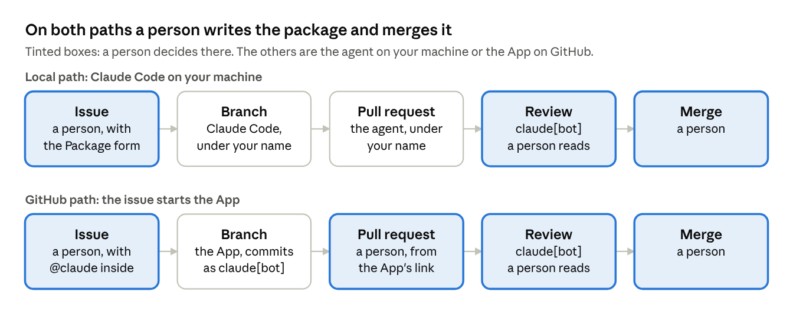
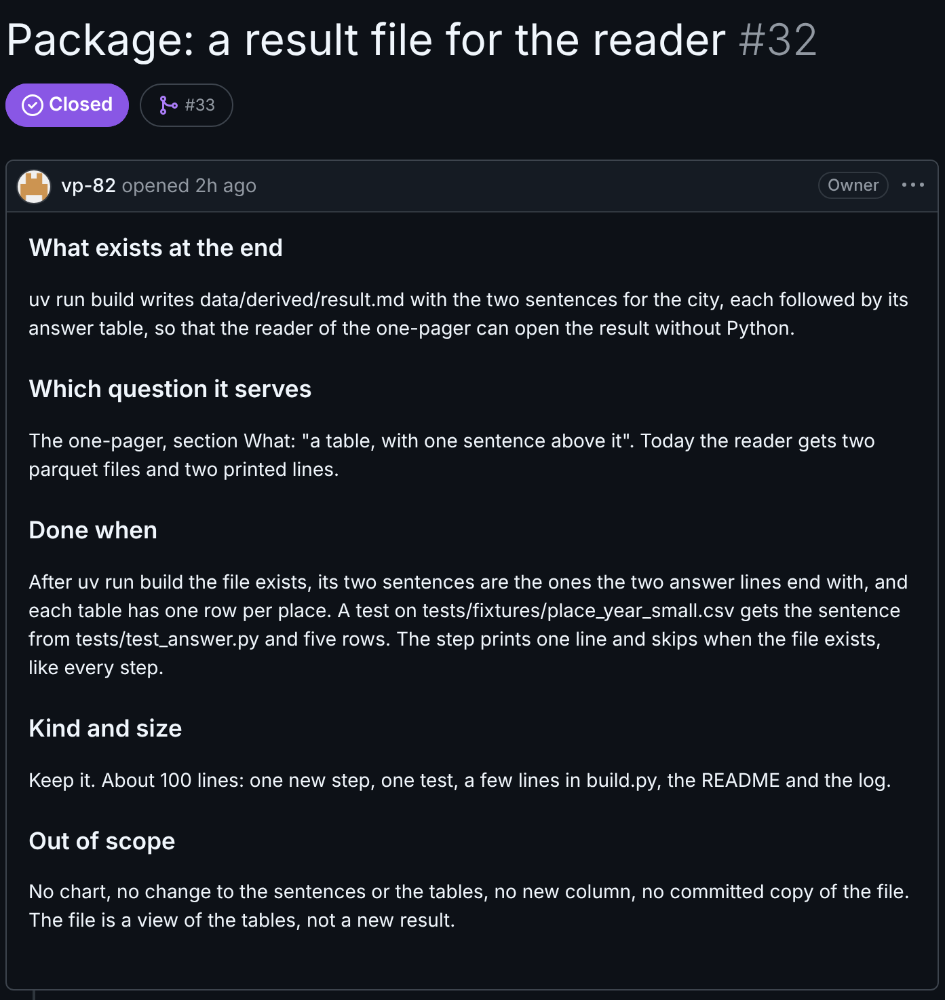
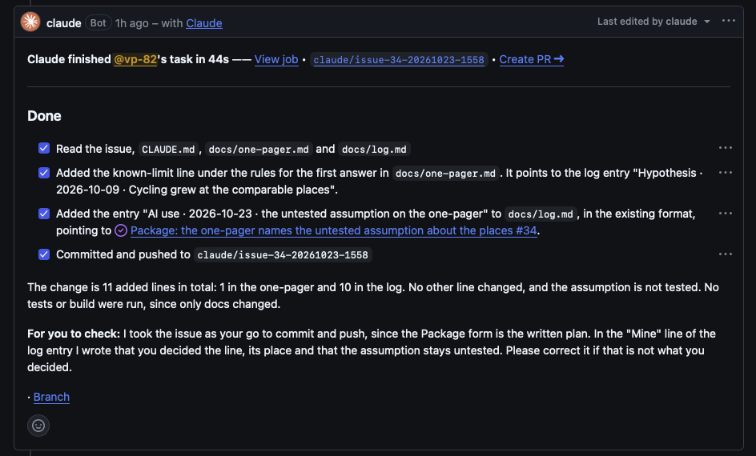
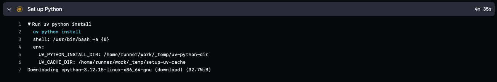

# DS-Projekt 2026 tutorial · Chapter 8 · A package is an issue

Oct 23, 2026 · Václav Pechtor

## What you have at the end

> [!TIP]
> **Before anything else: the agent solves the issue by making assumptions, and no issue names them all. Every assumption the agent does not ask about becomes a decision in your project, one you will have to justify later, in the team or at the end of the project, without having made it. So the minimum review is to read what the agent decided and to be able to say why, for each decision.**
>
> Everything in this chapter serves that. The issue is where the assumptions are supposed to be answered before the work, the plan is where the agent asks about the rest, and the log entry is where the ones it did not ask about are found.

Chapter 4 put a reviewer in front of every pull request. It reads the diff against your rules. What it cannot read is the purpose of the change, because the purpose was in your head, or in a pull request body written afterwards. This chapter writes the purpose down first. **A package is an issue, written by a person before the branch exists, in five fields.** The agent does the work from the issue, the pull request closes the issue, and the plan, the diff and the result can be held against it.

That is the point of the chapter. A pull request without a written package leaves every reviewer, human or bot, with "looks good". **A package written first gives them something to check, and it gives you something to say no to when the work drifts.**

Two ways, because a project is a team. The package one of you writes is done by an agent, but not always by the agent on your machine. From the keyboard: you are in the notebook, the next step is yours, you write the issue and say "Do issue 32." in Claude Code. From the browser: a teammate reads the one-pager on the train, sees that a known limit is missing, writes the issue with `@claude` in its first field, and the App has the branch ready before anyone opens a laptop. Whoever is free reviews and merges. The two packages of this chapter are those two cases: a pipeline step with a test from the keyboard, one line in the one-pager from the browser.

**Which path for which package: the laptop for code, for tests, for anything that has to run on your data, and for every package where you expect the plan to come back with questions. GitHub for a package that is text, a line in the one-pager, a rule, a log entry, and is checked by reading it.** A "find out" package is always the laptop. The reasons are in the section on the two paths: the plan, the data, the tests before the push and the choice of model for this one package are all on the laptop side.

At the end you have:

- **A package as an issue.** A form with five required fields: what exists at the end, which question it serves, done when, kind and size, out of scope. A person fills it before any branch exists.
- **Two packages done two ways.** One from Claude Code on your machine, where "Do issue 32." is the whole prompt. One from GitHub alone, where the issue itself starts the App. Both pull requests close their issue.
- **What a written package changes.** The plan found a file the issue had not named and asked before touching it. It missed a sentence that only a person reading the whole file catches. It offered the tempting next thing, and the issue had already said no.
- **Two open packages at once.** Each on its own branch from main, merged in either order, and the one place where they collided: the log.

No new tool. One file in the repository, the issue form, and one rule in `CLAUDE.md`.



The two lanes are the two paths. Tinted is where a person decides: the package, the review, the merge, and on the GitHub path the pull request itself. The names in the boxes are the names under which each step appears on GitHub.

## A package is an issue

The pull request this chapter is written against looks like this: a few hundred changed lines, a body of one line written after the work, no issue behind it, open for two weeks, and the next branch started on top of it. The method in such a repository can be fine, the hypotheses have their expectation and the log is kept. What is missing is the package as a written thing. **A reviewer, human or bot, reads the diff and can only say "looks good", because nothing says what good would be.**

The fix is one file, `.github/ISSUE_TEMPLATE/package.yml`, an issue form named "Package" with five required fields. From then on New issue offers the form, and `CLAUDE.md` carries the rule: a package starts as an issue that a person writes with the Package form before the branch exists, and its pull request closes that issue.

| Field | What it holds | Where it is checked |
| --- | --- | --- |
| What exists at the end | A file, a step, a sentence or a rule. One or two sentences, no how | The report in the pull request body, the result itself in doubt |
| Which question it serves | The line in the one-pager or the hypothesis in the log it belongs to | The one-pager and the log: is it needed |
| Done when | What someone else runs or reads to see that it is done, with the expected value | The test in CI, and the report of the build run |
| Kind and size | Find out, keep it or harden it, and about how many lines | The size and the file list GitHub shows on the pull request |
| Out of scope | What this package does not do, especially the tempting next thing | The plan and the file list against the field |

In practice, after a few weeks of agent-written code, nobody reads the diff, and a review that depends on it turns into a click. The checks in the table take a few minutes and no line of code. **What must not become a click is this: the agent solves the issue by making assumptions, and no issue names them all. Every assumption the agent does not ask about becomes a decision in your project, one you will have to justify later, in the team or at the end of the project, without having made it. So the minimum review is to read what the agent decided and to be able to say why, for each decision.** The decisions are in three places: the open points of the plan, the lines "what differs from the issue" in the pull request body, and the Mine and Delegated lines of the log entry. For #32 the Mine line lists seven, and the report adds the two expected rows the agent wrote. The review is done when you can account for each of them, and not before.



The first package of this chapter is a result file for the reader. The one-pager says the reader gets a table with one sentence above it. After chapter 7 the reader gets two parquet files and two printed lines. The issue, as written:

```text
Package: a result file for the reader

What exists at the end
uv run build writes data/derived/result.md with the two sentences for the city,
each followed by its answer table, so that the reader of the one-pager can open
the result without Python.

Which question it serves
The one-pager, section What: "a table, with one sentence above it".
Today the reader gets two parquet files and two printed lines.

Done when
After uv run build the file exists, its two sentences are the ones the two
answer lines end with, and each table has one row per place.
A test on tests/fixtures/place_year_small.csv gets the sentence from
tests/test_answer.py and five rows.
The step prints one line and skips when the file exists, like every step.

Kind and size
Keep it.
About 100 lines: one new step, one test, a few lines in build.py, the README and
the log.

Out of scope
No chart, no change to the sentences or the tables, no new column, no committed
copy of the file.
The file is a view of the tables, not a new result.
```

Two things in it were decided before the agent saw it. The file lives in `data/derived`, not in `docs`: `data` is gitignored, and a file the build writes is not committed, because a committed copy goes stale and a step that skips when its output exists would never rewrite it on a fresh clone. And the expected value in Done when is not a markdown table typed by hand, which nobody writes into an issue. It is the sentence that `tests/test_answer.py` already holds for the fixture `place_year_small.csv`, and the number of places in that fixture. **Fixtures and expected values accumulate, and a new package uses the old ones.**

Then, in Claude Code on `main`, the whole prompt:

```text
Do issue 32.
```

The agent read the issue, planned and stopped, as `CLAUDE.md` says. The plan named six files where the issue had named five, and five open points. Three were of the how kind, decimals, empty cells and the form of the log entry. The other two are the reason the issue exists. Found: `tests/test_build.py` lists the steps the build has to call, which is an expected value and therefore mine, and the agent asked before changing it. Offered: a title line at the top of the file, taken from the README. The issue does not have it, and Out of scope is there for exactly that. And one thing the plan missed: the paragraph after the steps table in `README.md` says "The last two lines are the sentences for the city", which stops being true once a new step prints last. **Only a person who reads the whole file catches that.**

The answer is one message, and it is the go for the files only:

```text
Answers to your open points:
1. Yes, add "result" to DERIVED_STEPS in tests/test_build.py.
2. One decimal for bikes per day and change_percent.
   Presentation only, the parquet tables stay as they are.
3. Nulls are empty cells.
4. No title. It is not in the issue. The file starts with the first sentence.
5. An AI use entry is enough.
   List points 1 to 4 and the file location under "Mine", and point to #32.

One thing your plan misses: README.md, the paragraph after the steps table, says
"The last two lines are the sentences for the city".
After your step that is no longer true.
Fix the paragraph so it says where the sentences are printed and that result.md
holds them.

Go for the files.
Run uv run pytest and uv run build, then stop and show me the test output, the
two sentences from the build, and the number of changed lines.
Do not commit yet.
```

The report came back with the test run, 19 tests, the build writing the file once and skipping it the second time, the two sentences in the file equal to the ones the answer lines end with, 44 rows per table, and 113 changed lines in six files against the issue's "about 100". And one thing the issue had not foreseen. The test checks the format decided in the answers, one decimal and empty cells, on two rows of the table, and the agent had written those two expected rows itself and said so in the report. `CLAUDE.md` reserves expected values for the person. The check takes one look at the fixture: a place with 100 and 120 bikes on 365 days in both years gives 100.0, 120.0, 20.0 and grew, a place with data in 2025 only gives empty, 60.0, empty, not comparable and "2019: no data". Both rows were right. **They became mine by that check, not by trust.**

Then the go for the commit, the push and the pull request, with "Closes #32" as the first line of the body, what was checked, and what differs from the issue. The bot review came back with "No issues found." The merge waited, because by then a second pull request was open. That is the next section.

> [!TIP]
> **The plan is checked against the issue, not against itself.**
>
> *Before:* the plan was the first written thing, so there was nothing to hold it against, and "looks good" was the only possible verdict. *After:* the issue named five files and a Done when. The plan found a sixth file and asked, missed a sentence in the README, and offered a title. Each of the three was visible because the issue was there to compare with.
>
> *The fix on the table:* name every file in the issue. It would buy nothing, because the plan is where the files appear anyway. It would cost the "no how" that keeps the issue short enough for a person to write before the work.
>
> *How to decide:* the issue says what exists at the end and when it is done, the plan says how, and the person reads the plan with the issue open.
>
> *What it did cost:* two sentences in the go.

> [!TIP]
> **An expected value the agent wrote is a proposal until the person has checked it against the fixture.**
>
> *Before:* the issue gave the sentence and the row count as expected values, nothing for the number format decided later in the answers. *After:* the agent filled that gap with two expected rows of its own, said so in its report, and the rows held against the five lines of the fixture.
>
> *The fix on the table:* forbid it in `CLAUDE.md`. It would buy nothing, the rule already says expected values are mine, and the agent did not break it, it flagged a gap the issue had left. It would cost a rule that stops the agent from proposing where the person forgot.
>
> *How to decide:* a flagged proposal is fine, a silent one is not, and the check is the person's every time.
>
> *What it did cost:* one look at a fixture of five rows.

## Two paths, one issue each

The second package of this chapter is a line of text. The log entry of 2026-10-09 says that whether the ten counting places stand for the whole city is an untested assumption. The one-pager, which the planner reads, does not say it yet. One line in the one-pager, one entry in the log, nothing to run. That is the package for the GitHub path, and it was written while the first pull request was still open.

The issue is the same form. The one difference is the first word of the first field: `@claude`. Chapter 4 set up the workflow that watches for it, and the App reads the issue as its whole instruction.

```text
Package: the one-pager names the untested assumption about the places

What exists at the end
@claude The one-pager lists, as a known limit under the rules for the first
answer, that whether the ten counting places stand for the whole city is
untested.
One line, pointing to the log entry "Hypothesis · 2026-10-09 · Cycling grew at
the comparable places".

Which question it serves
The one-pager's rules for the first answer.
The log entry of 2026-10-09 calls this an untested assumption, the one-pager
does not say it yet.

Done when
The line is in docs/one-pager.md under the rules for the first answer, and
docs/log.md has an AI use entry in the existing format that points to this
issue.

Kind and size
Keep it. About 10 lines.

Out of scope
No test of the assumption. No change to any other line.
```

Forty-four seconds after the issue was opened the App had read the issue, `CLAUDE.md`, the one-pager and the log, added the line and the entry, and pushed a branch. Its comment on the issue ends with a line worth reading twice: "For you to check: I took the issue as your go to commit and push, since the Package form is the written plan." `CLAUDE.md` says to plan and wait for the go, and on GitHub there is nobody to wait for. **The App named the rule it bent and why, and put the decision where a person sees it.** That is the same behaviour chapter 7 saw from the skill, and it is the reason the first field of the form is written the way it is.



**What the App does not do is open the pull request.** Its comment ends with a link, "Create PR", to a page where the pull request is already filled in, and a person clicks it. That is how the action is built: it works on a branch and hands back the link, and in the stock workflow it has no shell, so it could not open the pull request by command either. On this path the pull request is the person's, and that has a consequence a few lines down.

|  | Laptop: Claude Code | GitHub: the App |
| --- | --- | --- |
| Who writes the issue | A person, with the form | A person, with the form and `@claude` in the first field |
| What starts the work | "Do issue 32." in the session | Opening the issue |
| Plan and open points | Plan, stop, questions, go | None. The issue is the whole instruction |
| Data | `data/raw` on the machine | None. A fresh runner, no downloads |
| Tests before the push | `uv run pytest` and `uv run build`, reported before the commit | None. CI runs after the push, on the pull request |
| Commits appear as | Your name | `claude[bot]` |
| Who opens the pull request | The agent, after the go | A person, from the App's "Create PR" link |
| Model | Chosen per package, `claude --model` or `/model` | One line in `claude.yml`, the same for every run |
| Review workflow | Runs, the pull request is yours | Runs, the pull request is yours |
| Resolving a conflict | One message, tests before the push | A comment on the pull request, tests after |

The one line to take from the comparison is the model. On the laptop the model is chosen per package: `claude --model` at the start or `/model` in the session, and a package that needs the stronger model gets it. On GitHub the model is one line in `claude.yml`, `--model` under `claude_args`, and every run uses it. **Without that line the App takes Claude Code's default, which is not a weaker model, it is a fixed one.** That, and the plan, the data and the tests before the push, is why the rule of thumb in the first section puts code on the laptop and text on GitHub.

Then both pull requests were open at the same time. Each on its own branch from `main`, each closing its own issue, each green, each mergeable in either order. That is the picture the students' repository did not have, where the next branch started on top of the open pull request and the second could not merge before the first. Two branches from `main` do not depend on each other, until they touch the same line.

They did. Both packages append an entry to `docs/log.md`, at the same place, the end. The first merge went through, the second showed "This branch has conflicts that must be resolved" in one file. **That is not a mistake in either package, it is a property of one shared log that every package writes to, and it will happen to every pair of open packages in this project. The order of the merges decides where the conflict lands.** The text package was merged first, so the conflict was on the laptop side, where one message resolves it:

```text
Pull request 35 is merged.
Merge main into result-file and resolve the conflict in docs/log.md: keep both
entries, the one for #32 first, then the one for #34.
Run uv run pytest, then stop and show me the end of docs/log.md and the test
output.
Do not push yet.
```

The agent kept both entries in that order, 19 tests passed, and after the go the push put the merge commit on the pull request. The review workflow ran again on it, the second pull request merged, and `main` holds both packages. The other order would have left the conflict with the App, which can take a comment on the pull request but cannot run the tests before it pushes.

> [!TIP]
> **On the GitHub path a person opens the pull request, and that is why the review runs.**
>
> *Before:* chapter 4's decision skips the review workflow when the event comes from `claude[bot]`, because the action refuses runs started by a bot. On the App's path every commit is `claude[bot]`'s, so it looked as if its work would get no review. *After:* the "pull request opened" event comes from whoever clicks "Create PR", a person, and the review ran on the App's work exactly like on the agent's.
>
> *The fix on the table:* give the App a shell and `gh pr create` in `claude.yml`, so the pull request appears without a click. It would buy one click per package. It would cost the review on that path, and the one point where a person sees the App's work before anything else happens to it.
>
> *How to decide:* a step a person has to take is not a defect when it is the step that puts a person in front of the work.
>
> *What it did cost:* one click, and a line in `CLAUDE.md` is not needed.

> [!TIP]
> **Two open packages collide where both write. The log is that place.**
>
> *Before:* two branches from `main`, independent by construction. *After:* a conflict in `docs/log.md` on the second merge, resolved by one message and one look at the end of the file.
>
> *The fix on the table:* one log file per package, or entries in separate sections, so that two packages never touch the same line. It would buy clean merges. It would cost the one record a reader can read top to bottom, in order, which is what the log is for.
>
> *How to decide:* merge the cheap package first, so the conflict lands where the tests run. The conflict is the log doing its job.
>
> *What it did cost:* one message, and the merge commit on the pull request.

## What happened beyond the packages

**The form came in a package of its own.** Pull request [29](https://github.com/vp-82/ds-projekt-2026-tutorial/pull/29) added the form and the rule, and could not close an issue, because the form did not exist before it. Its review found that the rule in `CLAUDE.md` said less than the form, "written with the Package form" against "a person writes, before the branch exists", and **the same rule in two places has to say the same thing**. The fix, and the points the review raised that had not been decided, are in pull request [31](https://github.com/vp-82/ds-projekt-2026-tutorial/pull/31) and the log entries of 2026-10-23.

**The form is a default, not a lock.** `blank_issues_enabled: false` in `.github/ISSUE_TEMPLATE/config.yml` makes New issue offer only the Package form. It does not stop anyone with write access from editing the title prefix away, and `gh issue create` from the command line cannot fill a form at all. **The repository makes the convention the easy path. Keeping it is the team's.**

**Two things from the real world.** They will happen in your project, and neither is about your code.

The bot review wrote the same sentence on both pull requests of this chapter: "No issues found. Checked for bugs and CLAUDE.md compliance." Once on 113 changed lines with a new step and a test, once on 11 lines of text. The review reads the diff against `CLAUDE.md`, and on a diff of one line there is nothing for it to find. **That sentence is not a verdict on the package.** The verdict is the person's reading of the plan, the report and the log entry against the issue, as the second section says, and the bot's sentence does not shorten it.

The Tests check on the text package took ten minutes. The tests themselves took 0.38 seconds. The nine minutes in between were the GitHub runner downloading Python before the first test could run, a 33 MB download that usually takes seconds and that day did not. **Nothing in the pull request can cause that, and nothing in the pull request can fix it.** When a check sits on a download for longer than ten minutes, cancel the run and start it again. A fresh runner usually gets through in under a minute.



## For your own project

**The pitfall first, because it cannot be said often enough: the agent solves the issue by making assumptions, and every assumption it does not ask about becomes a decision in your project that you will have to justify without having made it. Nothing below replaces knowing what the agent decided and why.**

1. **Set it up with the agent, not by hand.** In Claude Code, in your repository: "Add a GitHub issue form named Package with five required textarea fields: What exists at the end, Which question it serves, Done when, Kind and size, Out of scope. Switch blank issues off. Add the rule to CLAUDE.md: a package starts as an issue that a person writes with the Package form before the branch exists, and its pull request closes that issue. Plan first." The plan will ask about the field descriptions and the title prefix. Those are yours, and the ones from this chapter are in the repository to copy. Then check by hand that New issue offers the form, as issue #30 did here, because no test can.
2. **Write the issue before the branch exists, and write it short.** One or two sentences per field, no how. The expected value in Done when comes from a fixture and a test you already have, or from a number you can name. A table typed into an issue is a sign that the package is too big.
3. **The whole prompt is "Do issue N."** Everything else the agent needs is in the issue, `CLAUDE.md` and the repository. If the prompt needs more, the issue is missing it.
4. **Read the plan with the issue open.** Three things to look for, every time: a file or a value the issue did not name, which the agent should ask about, a sentence elsewhere in the repository that the change makes untrue, which only a person catches, and the tempting next thing, which Out of scope has already answered.
5. **Know every decision the agent made and be able to say why.** That is the minimum review, and it needs no diff. The decisions are in the open points of the plan, in "what differs from the issue" in the pull request body, and in the Mine line of the log entry. An expected value the agent wrote is a proposal until you have checked it against the fixture.
6. **Laptop for code, tests, data and every package where you expect questions. GitHub for a line of text checked by reading.** The laptop gives you the plan, the data, the tests before the push and the model per package. The App gives you none of those and needs none for a line of text.
7. **On the GitHub path a person opens the pull request.** That click is what puts the review workflow in front of the App's work. Do not automate it away.
8. **Two open packages are two branches from `main`, never one on top of the other.** They will collide in the log, because every package writes to it. Merge the cheap one first, so the conflict lands where the tests run, and resolve it with one message that names both entries and their order.
9. **Know who pays.** The App runs on the token one person created with `/install-github-app`, and every `@claude` run and every review on the repository counts against that person's subscription, whoever triggered it. In a team repository, decide that before the first `@claude`, and consider an API key with a spending limit instead of one person's token. GitHub Actions minutes are free on a public repository and counted on a private one.
10. **The bot's "No issues found" is not a verdict on the package**, and a check that sits on a download is not your code. Cancel and rerun after ten minutes.

---

The chapter ends here. The next one goes deeper into one tool.

---

Previous: [Chapter 7 · The method becomes a tool](chapter-7.md) · [Overview](README.md)
