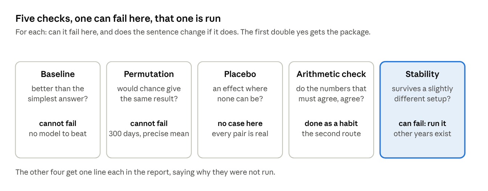
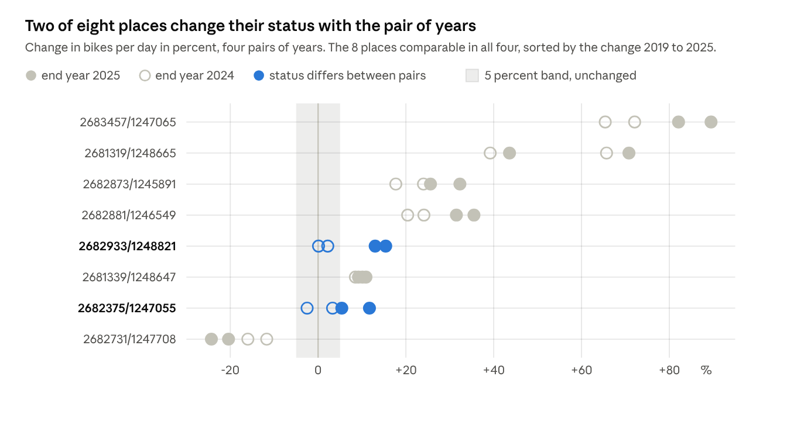

# Chapter 9 · One check that can fail

Oct 25, 2026 · Václav Pechtor

## What you have at the end

> [!TIP]
> **Before anything else: every central number in your report gets one check before it goes in, and it is the check whose failure would change your sentence. A check that cannot fail is not a check, it is reassurance, and it costs a package. The expectation is written before the run, so the check cannot be bent afterwards.**
>
> This chapter does one such check on the example. The rule above is what you take. The example is only the evidence that it works.

Chapter 5 ended in a sentence: yes, 8 of 10 comparable places grew. Chapter 6 asked whether it holds on dry weekdays, and it did. Chapter 7 asked whether it survives a fresh clone and public holidays, and it did. Nobody has yet asked the question a planner will ask in the first minute: is that because cycling grew, or because 2019 and 2025 happen to be the two years you picked?

That question is a stability check. It is one of five checks a result can be put through, listed below, and the rule for choosing among them is the same for every project, whatever the data. **Go through the five and ask of each: can this one fail here, and if it fails, does my sentence change? The first one where both answers are yes is the check you run. The others are not run, and the report says so in a line.**

| Check | The question it asks | Can it change the sentence here |
| --- | --- | --- |
| Baseline | Is the result better than the simplest answer | No. The sentence compares a place with itself, there is no model to beat |
| Permutation | Would chance give the same result | No. With about 300 days per place and year, the yearly mean is precise to a few percent, and a resampling of the days would confirm every status |
| Placebo | Does the method find an effect where none can be | Not with this data. A placebo needs a comparison where nothing changed, and every pair of years here is a real pair |
| Arithmetic check | Do the numbers that must agree, agree | Already done. The second route in chapter 7 and the row counts in chapter 8 |
| Stability | Does the result survive a slightly different setup | **Yes. Four other years are in the table, and a second pair that says no would end the sentence** |

The second row is the trap worth naming, because it is where most people start. A bootstrap over days, resample the days of each year, recompute the means a hundred times, is the first thing a statistics course suggests, and here it cannot fail: the mean of 300 days is a precise number whether or not 2025 was a special year. **Precision is not stability.** The bootstrap measures how well the number is known. The other years measure whether it is a trend. Two sentences in the log, no package.

At the end you have:

- **One check, chosen for being able to fail.** The sentence for the city recomputed for three other pairs of years, with the expected result written in the issue before anything ran.
- **A failed part, with its number.** The city held in every pair. The status of a single place did not: 2 of the 8 places comparable in all four pairs grow only when the end year is 2025. That is the result, and it went into the one-pager as a known limit with both places named.
- **The check on the check.** The agent recomputed all four pairs a second way, without the project's own function, and got the same counts. That is the arithmetic check, done as a habit rather than a package.
- **A new open question.** 2024 looks like a weaker year citywide, which is assumption 11 of chapter 1 (a wet year looks like a decline) showing up in the data. It is a hypothesis for the next loop, not a line in this chapter.

No new tool and no new library. One package of 30 lines to make the years parameters, one run of the hypothesis skill from chapter 7, and the five-row table above.



Five questions, one answer each. Only the last one can turn out yes and no at the same time, and that is the one that gets a package.

## The check that can fail

The check needs the comparison for a pair of years other than 2019 and 2025. `answer.py` had the two years as constants, so the first package is not the check, it is the thirty lines that make the check possible: the years become parameters of `place_change_table`, with 2019 and 2025 as defaults so that the build does not change. It had its own issue (#39), its own expected value on the fixture from chapter 5 (the pair 2019 and 2022 gives "1 of 1 comparable places grew, 0 shrank, 0 are unchanged, 4 places cannot be compared", one look at the five fixture rows says why), and its own pull request (#41). **A check that needs a code change gets two packages, the change and the check, never one.** The change is reviewed as code, the check is reviewed as a hypothesis, and the second cannot hide a mistake in the first.

The check itself is the second issue, and its Done when is the expected result:

```text
Package: the answer checked on other pairs of years

What exists at the end
A Hypothesis entry in docs/log.md for "the answer holds for other pairs of
years", run with /hypothesis on the three pairs 2018 to 2024, 2018 to 2025 and
2019 to 2024, and one line under Done in docs/one-pager.md that points to it.

Which question it serves
Whether "yes, 8 of 10 comparable places grew" depends on the two years chosen.
The stability check, the one of five checks on a result that can change the
sentence for the city.
A bootstrap over days cannot, with about 300 days per place and year the mean is
precise, so it is not run.

Done when
The entry has Expected, written before the run: at least 8 places comparable in
each of the three pairs, the city yes in all three, and the places comparable in
all four pairs keep their status in at least three of four.
Then Test, Result with the sentence and the counts per pair, and Decision.
The one-pager line names the three pairs and the result in one sentence.

Kind and size
Find out.
About 25 lines of docs.
The probe script stays in the session scratchpad, as the skill does it.

Out of scope
No change to the rules for the first answer, no new step in the build, no change
to the answer tables, no bootstrap.
```

Why these three pairs: 2018 and 2024 are the nearest years to the two in the first answer that are still full years before and after the pandemic, so the three pairs replace one end, the other end, and both. Why three parts in the expectation: each part can fail on its own, and a yes on the city with a no on the places is a different result from a no on both. **An expectation with one yes or no hides which part broke.**

The run is one line in Claude Code:

```text
/hypothesis The answer holds for other pairs of years: 2018 to 2024, 2018 to
2025 and 2019 to 2024
```

The skill from chapter 7 restated the hypothesis and stopped with three questions before asking for the expected result. All three were the right questions, and none of them was in the issue:

1. All days or dry weekdays. The dry-weekday answer would need the weather files for 2018 and 2024, which are not in `data/raw`.
2. What "holds" means. Only that yes stays yes, or also that the same places grow and shrink.
3. Which places are compared. The 300-day rule applied to each pair gives a different set of comparable places per pair. The other reading keeps the ten places of the first answer for every pair.

The answers are decisions, and they are the person's, so they went back as one message: all days, the rule applied per pair, and the expectation in three parts with the words that make each part checkable:

```text
1. All days, loop one.
   The dry-weekday answer is out of scope, the weather files for 2018 and 2024
   are not there.
2. The 300-day rule is applied to each pair, so the set of comparable places may
   differ per pair.
   That is the reading issue 39 was built for.
3. Expected result, in three parts, all three must hold:
   a. At least 8 places are comparable in each of the three pairs.
   b. The sentence for the city is yes in each of the three pairs.
   c.
For every place that is comparable in all four pairs (the three new ones and
2019 to 2025), its status from 2019 to 2025 (grew, shrank or unchanged) is the
same in at least two of the three new pairs.
Report per pair: the number of comparable places, the counts of grew, shrank and
unchanged, and the sentence.
Report per place comparable in all four pairs: the four statuses.
```

The skill then proposed the test and stopped again. Two things to read in such a proposal, every time: where the data comes from, here `data/derived/place_year.parquet` and nothing from `data/raw`, and the list of how the test can fail the expectation, one line per part. **A proposed test that cannot name how it fails is a test that will pass.** This one named a failure for each of the three parts and one more, no rows for 2018 or 2024. Then the go.

## What it found

Two parts held, one did not.

| Pair | Comparable | Grew | Shrank | Unchanged | City |
| --- | --- | --- | --- | --- | --- |
| 2018 to 2024 | 11 | 7 | 1 | 3 | yes |
| 2018 to 2025 | 10 | 8 | 1 | 1 | yes |
| 2019 to 2024 | 10 | 6 | 1 | 3 | yes |
| 2019 to 2025, the first answer | 10 | 8 | 2 | 0 | yes |

Part a: 11, 10 and 10 comparable places, at least 8 in every pair. Part b: yes in every pair. **The sentence for the city does not depend on the two years.** That is a stronger statement than chapter 5 could make, and it cost one run.

Part c did not hold. 8 places are comparable in all four pairs. 6 of them keep their status from the first answer in all three other pairs. 2 keep it in only one, and both in the same way: they grew when the end year is 2025 and are unchanged when it is 2024.



The two places are not the same case, and reading the numbers tells them apart:

- **2682375/1247055** has 5.4 percent more bikes per day in 2025 than in 2019, the change the first answer is built on, one point above the 5 percent band. In the other pairs the change is +3.3, +11.7 and −2.5 percent. A place that close to the band flips with any change of years. That is not a flaw in the data, it is the band doing its job: it says "grew" about a place whose growth is small, and the other pairs say how small.
- **2682933/1248821** has 13.0 and 15.4 percent more bikes per day when the end year is 2025, and 2.2 and 0.1 percent more when it is 2024. That is not the band. That is 2024 against 2025. The city row says the same: 2019 to 2024 gives 6 grew and 3 unchanged, 2019 to 2025 gives 8 and 0. 2024 looks like a weaker year citywide.

The decision, written into the log in the person's words: the answer for the city stands and is stronger than before, the status of a single place is not stable and the one-pager says so, the rules stay, and whether 2024 was a weak year for the whole city is a question for a later loop. Two lines went into the one-pager in the same package, a known limit under the rules for the first answer with both places named, and a line under Done that the city sentence held for three other pairs. That bends step 6 of the skill, which does not touch the one-pager, and the AI use entry says so, as it did for the holidays in chapter 7.

One more line in that entry is worth copying as a habit. Under Checks passed, the agent recomputed all four pairs a second way, from `place_year.parquet` directly, without `place_change_table`: keep the place-years with at least 300 days, join the two years, apply the band. Every count and both places' changes came out the same. **A second route through the data is the cheapest check on a check, and it costs the agent minutes.** The full entry is in the log, "Hypothesis · 2026-10-25".

> [!TIP]
> **A check that cannot fail is not a check.**
>
> *Before:* the five checks looked like a list to work through, and the bootstrap over days looked like the first one to run. *After:* four of the five could not change the sentence here, and the bootstrap would have confirmed every status without saying anything about the years. One check was run, the one with a real no in it, and it found one.
>
> *The fix on the table:* run the bootstrap anyway, for completeness. It would buy a line in the report that the means are precise, which 300 days per year already say. It would cost a package and a reader's attention.
>
> *How to decide:* for each check, can it fail here, and does my sentence change if it does. Run the first yes. Write one line for the others.
>
> *What it did cost:* a five-row table in the chapter, and two sentences in the issue.

> [!TIP]
> **Precision is not stability.**
>
> *Before:* "8 of 10" read as one number with one uncertainty. *After:* it has two. How well the yearly means are known, which 300 days settle, and whether the two years are typical, which only other years can settle. The bootstrap answers the first. The other pairs answer the second, and the second is the one the planner will be asked about.
>
> *The fix on the table:* report an interval around every change from a bootstrap. It would buy a number that looks like rigour. It would cost the reader the belief that the number covers the question of the years, which it does not.
>
> *How to decide:* name which uncertainty the sentence has, then pick the check that measures that one.
>
> *What it did cost:* nothing in the repository. Two sentences in this chapter.

> [!TIP]
> **A failed part is the result, and it goes into the report with its number.**
>
> *Before:* the one-pager said nothing about the years. *After:* it says, under the rules, that the status of a place can depend on the pair of years, measured as 2 of 8 places on 2026-10-25, both named, and under Done that the city sentence held for three other pairs. A planner who is asked "and what about 2024" has the answer in the document.
>
> *The fix on the table:* change the rules so that the two places stop flipping, for example a 10 percent band. It would buy a cleaner table. It would cost the rule that was fixed before any comparison was computed, and the chapter 5 reason for fixing it, which was exactly that the rules are not tuned to the result.
>
> *How to decide:* a check changes the rules only when the question needs it. The question is the city, and the city held.
>
> *What it did cost:* two lines in the one-pager, 43 lines in the log.

## What happened beyond the check

**The years as parameters.** Issue [39](https://github.com/vp-82/ds-projekt-2026-tutorial/issues/39) and pull request [41](https://github.com/vp-82/ds-projekt-2026-tutorial/pull/41): two parameters with the old constants as defaults, the reason strings that name the years, one test on the chapter 5 fixture. The build, both answer tables and `result.md` did not change by a byte, which is what "harden it" means. A package that makes a check possible is written and reviewed before the check, and its pull request closes its own issue.

**2024 is now an open question, and it was already in the list.** Chapter 1 rated twelve assumptions. Number 11 says the weather is comparable across years, so that a wet year does not look like a decline in cycling. It has been untested since. The pairs ending in 2024 have fewer places growing than the pairs ending in 2025, which is what a wet 2024 would look like, and also what a real dip would look like. Telling them apart is one hypothesis away: the dry-weekday comparison from chapter 6 for 2019 to 2024, which needs the weather file for 2024 and nothing else new. It is in the log as a question for a later loop, not answered here, because the question of this chapter was the city, and the city held.

**The rule in the one-pager now has three known limits with a size**, the partial outage from chapter 5 without one, the public holidays from chapter 7 with one place, and the pair of years from this chapter with two places. A reader of the one-pager sees what was tested, what was not, and how much each untested thing could move the answer. That is what the Done section promised in chapter 1.

## For your own project

**The pitfall, once more: a check you run because it is the one you know how to run proves nothing. A check is chosen for being able to fail, and the expectation is written before it runs.**

1. **Every central number gets one check before the report.** Not five. The one whose failure would change the sentence. The five checks at the top of this chapter are the ones to choose from, and the choice is the work.
2. **Ask of each check: can it fail here, and does my sentence change if it does.** Write the answer for all five in a table of five rows, as above. Run the first double yes. The table is the line in the report that says why the others were not run.
3. **Precision is not stability.** A bootstrap, a confidence interval and a standard error say how well a number is known from the data you have. They say nothing about whether the slice of data you have is typical. If your sentence rests on two periods, two regions or two groups, the check is a third one.
4. **Write the expectation in parts, one per thing that can fail on its own.** "At least 8 comparable, yes in all three, the same status in at least two of three" can fail in three ways, and the report says which one did. "The answer holds" can only fail as a whole.
5. **A check that needs a code change gets two packages.** The change first, with its own issue, expected value and pull request. The check second, as a hypothesis. The second cannot hide a mistake in the first.
6. **Read the proposed test for two things:** where the data comes from, and one line per part of the expectation that says how the test can fail it. A test that cannot name its failure will pass.
7. **Ask for a second route.** The same counts from the raw table without the project's own function. It costs the agent minutes, and it is the arithmetic check done as a habit.
8. **A failed part is a result.** It goes into the report with its number and the names of the cases, as a known limit under the rule it limits. The rule changes only when the question needs it, and a check that was designed to be able to fail does not get its rules bent after it did.
9. **Keep the open question the check produced.** A failed part usually points at the next hypothesis. Write it as one, with the data it would need, and leave it for the next loop.

---

The chapter ends here. The next one goes deeper into one tool.

---

Previous: [Chapter 8 · A package is an issue](chapter-8.md) · [Overview](README.md)
